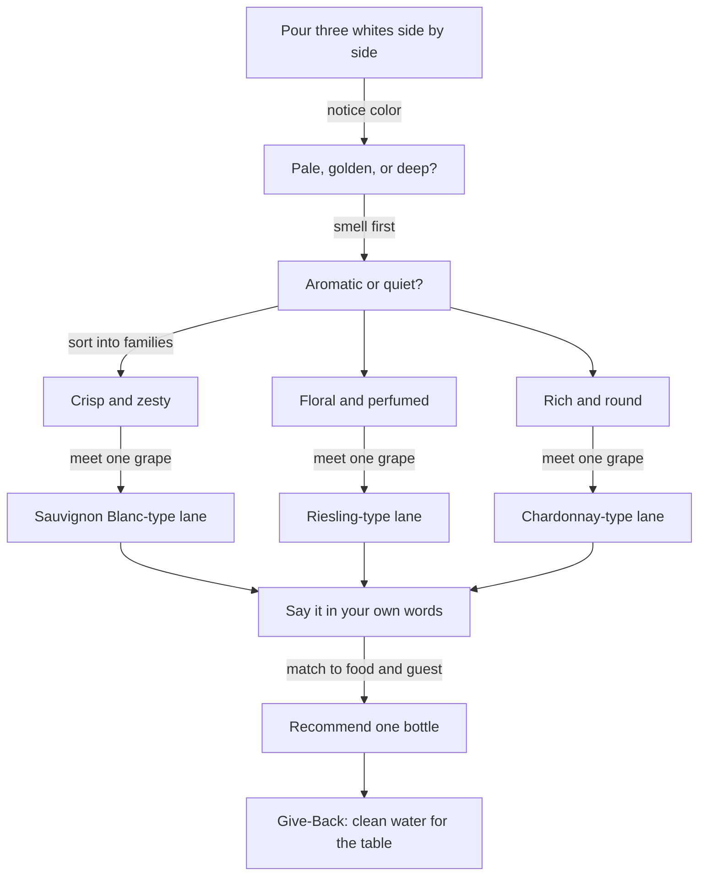

*Sip Studios › Ai Edu · Water to Wine*

## 02 · Meeting White Grapes
**Purpose:** A guided meet-and-greet with white grapes — how to group them, taste them, and talk about them.

**What you practice**
- Sorting whites into three Sip Studies families: Crisp, Floral, Rich
- Describing one grape in plain words a guest would understand
- Spotting how oak or no-oak shifts a white's feel
- Picking one white for one dish

**Source vs Flow:** *Source* — name a grape and its family. *Flow* — compare two grapes, explain the climate link, and recommend one to a guest.

**Bridge callout:** Grape spirits (brandies, pomace spirits) start from grapes like these — same fruit, a different house.

**Give-Back:** Learners pair each white with a glass of water in the tasting and note how water resets the palate — the simplest hospitality act, and the one Somm Support funds.

**Print hint:** Sand background, Deep Teal family boxes, Clay "recommend" node.
