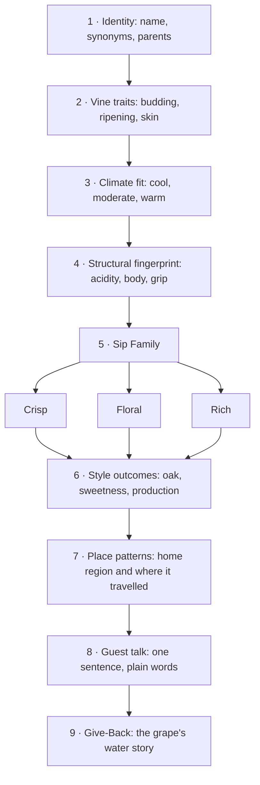

*Sip Studios › Ai Edu · Water to Wine*

## 02 · White Grape Varieties — Species Analysis
> Original Sip Studies teaching material. Variety names are public, common names. Not affiliated with, endorsed by, or derived from any court, guild, or credentialing body.

**Purpose:** Analyze the core white wine grapes as plants and as styles: who each variety is, where it grows best, how its structure reads, and how to explain it to a guest.

### How to analyze a grape (Sip Studies nine steps)

**Sip Families (white):** *Crisp* = high acid, light body, little or no oak · *Floral* = aromatic, perfumed, often lower acid or with sweetness · *Rich* = fuller body, often oak, ripeness, or lees texture. A variety can move between families depending on climate and winemaking (shown with →).

### Variety analysis table (11 varieties)

| Variety | Sip Family | Vine traits | Climate fit | Structure (acidity · body · grip) | Style cues | Place patterns | Water / Give-Back note |
|---|---|---|---|---|---|---|---|
| **Albariño** | Crisp | Thick-skinned, holds up to damp sea air; often grown on high pergolas | Cool, wet, coastal | High · light–medium · none | Mostly steel tank, no oak; dry; sometimes rests on its yeast for texture | Atlantic Iberia (Galicia, northern Portugal as Alvarinho); a few US coastal sites | Rain-fed coastal vineyards: compare to drought-stressed inland sites |
| **Chardonnay** | Rich (can be Crisp) | Early budding, frost-prone; very adaptable, a winemaker's blank canvas | Cool to warm; style follows climate | Medium–high · medium–full · none | Widest range: steel and lean, or barrel-fermented, buttery, and round; also a core sparkling grape | Burgundy and Champagne home; California, Australia, Chile, Oregon, many more | Same grape, many climates: a lesson in how water and heat shape one plant |
| **Chenin Blanc** | Crisp → Rich | Vigorous, buds early, ripens late; prone to noble rot in misty sites | Cool-moderate to warm | Very high · light–full · none | Every sweetness level from bone dry to dessert; still or sparkling; oak optional | Loire Valley home; South Africa's most planted white; some California | South African old bush vines are often dry-farmed: a water-wise model |
| **Gewürztraminer** | Floral | Pink-skinned, low-yielding, buds early; sensitive to frost and disease | Cool, sunny, dry autumns | Low · full · slight phenolic grip | Dry to sweet; usually no oak; perfumed and oily-textured | Alsace, northern Italy (Alto Adige), Germany; cool US/NZ sites | Low-acid grape: teach why cool nights (and water in the soil) keep it balanced |
| **Pinot Grigio / Pinot Gris** | Crisp (Grigio) · Rich (Gris) | Grey-pink skin, a color mutation of Pinot Noir; early ripening | Cool to moderate | Medium · light–full · none | Two names, two styles: light and zippy (Grigio) or riper and rounder (Gris); rarely oaked | Northeast Italy, Alsace, Oregon, New Zealand | Mutation story: one vine family, many faces, same water needs |
| **Riesling** | Floral (and Crisp) | Hard wood resists winter cold; late ripening; reflects soil strongly | Cool, long seasons, steep slopes | Very high · light–medium · none | Bone dry to very sweet; almost never oaked; ages for decades | Germany home; Alsace, Austria, Australia's cool valleys, New York Finger Lakes, Washington | Steep river slopes: how rivers temper climate and support growers |
| **Sauvignon Blanc** | Crisp | Vigorous vine; needs canopy control to keep grassy vs ripe balance | Cool to moderate | High · light–medium · none | Mostly steel and fresh; some barrel-aged and blended with Sémillon | Loire Valley and Bordeaux home; New Zealand, Chile, South Africa, California | Irrigation and vigor: more water = more leaves = greener style |
| **Torrontés** | Floral | Argentine crossing (Muscat parent); thrives at extreme altitude | High-altitude desert: hot days, cold nights | Medium · medium · slight | Dry, unoaked, aromatic | Argentina's high north (Salta) and Mendoza/La Rioja | Desert vineyards rely on snowmelt irrigation: a direct water-access story |
| **Grüner Veltliner** | Crisp | Native Austrian; high-yielding unless restrained; loves loess soils | Cool continental | High · light–full · none | Mostly dry, unoaked; light everyday to rich reserve styles | Austria (Danube valleys); small plantings in US, NZ, Australia | Danube terraces: river water and stone walls that store heat |
| **Viognier** | Floral → Rich | Low, irregular yields; needs full ripeness to show its character | Warm, sunny | Low · full · slight | Dry, often lightly oaked; sometimes co-fermented with Syrah | Northern Rhône home; California, Australia, Virginia | Heat-loving grape: discuss water stress in warming climates |
| **Sémillon** | Rich | Thin skin, prone to noble rot; ages into honeyed richness | Moderate; misty autumns for sweet styles | Low–medium · medium–full · none | Dry blends with Sauvignon Blanc, or sweet botrytis wines; ages well | Bordeaux (including sweet Sauternes); Australia (Hunter Valley) | Morning river mist creates sweet wines: water as a winemaking ingredient |

*Place patterns are high-level teaching anchors, not a complete or official list. Learners confirm current regional rules from official sources.*

**What you practice**
- Run the nine-step analysis on one variety and fill one table row from memory
- Explain how climate moves a grape between Crisp and Rich (Chardonnay, Chenin Blanc)
- Name a variety's home region and one place it travelled to
- Say one guest-ready sentence per variety

**Source vs Flow:** *Source:* name each variety, place it in its Sip Family, and give its climate fit and one home region. *Flow:* compare two varieties step by step (for example Riesling vs Gewürztraminer), predict style from climate and winemaking, and recommend one to a guest with a reason.

**Bridge callout:** Grape spirits (brandies, pomace spirits) start from white grapes like Ugni Blanc, Folle Blanche, and Muscat relatives: same fruit, a different house.

**Give-Back:** Each variety row ends with a water note. Learners pick one white and write its water story in two sentences: how the vine gets its water and one way a grower saves it. Somm Support uses these stories at Water to Wine events.

**Print hint:** Sand background, Deep Teal table header, Mint Mist rows for Crisp, Mauve-Grey tint for Floral, Clay accent for Rich.
