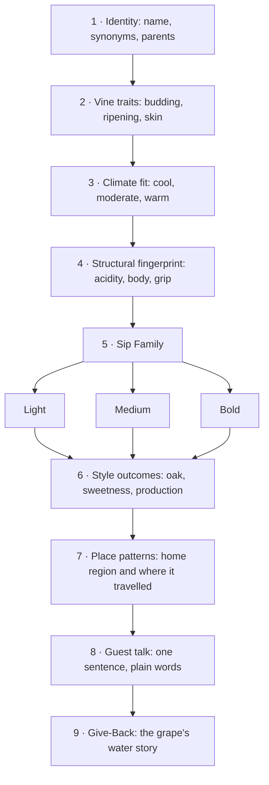

*Sip Studios › Ai Edu · Water to Wine*

## 03 · Red Grape Varieties — Species Analysis
> Original Sip Studies teaching material. Variety names are public, common names. Not affiliated with, endorsed by, or derived from any court, guild, or credentialing body.

**Purpose:** Analyze the core red wine grapes as plants and as styles: skin, ripening, structure, place, and how to explain each one to a guest.

### How to analyze a grape (Sip Studies nine steps)

**Sip Families (red):** *Light* = pale, high acid, low grip · *Medium* = balanced fruit, acid, and grip; often savory · *Bold* = deep color or high tannin, full body, often oak. Skin thickness and climate decide most of the move between families (shown with →).

### Variety analysis table (14 varieties)

| Variety | Sip Family | Vine traits | Climate fit | Structure (acidity · body · grip) | Style cues | Place patterns | Water / Give-Back note |
|---|---|---|---|---|---|---|---|
| **Cabernet Franc** | Medium | Buds and ripens earlier than Cabernet Sauvignon; hardy in cooler sites | Cool to moderate | Medium–high · medium · medium | Unoaked and fresh or barrel-aged; key blending partner | Loire Valley and Bordeaux; Finger Lakes, Virginia, Argentina | Cooler-site grape: lower irrigation needs than many bold reds |
| **Cabernet Sauvignon** | Bold | Small, thick-skinned berries; late ripening; offspring of Cabernet Franc × Sauvignon Blanc | Warm, long seasons; gravelly, well-drained soils | Medium–high · full · high | Usually oak-aged; blended or single variety; long aging | Bordeaux (Left Bank) home; Napa, Washington, Chile, Australia, South Africa | Well-drained gravel: how soil holds or sheds water |
| **Gamay** | Light | Early budding and ripening; high yielding | Cool to moderate | High · light · low | Often whole-cluster fermented for juicy freshness; rarely oaked; served slightly cool | Beaujolais home; Loire, Switzerland, Oregon | Granite hillside vineyards rely on rain: a dry-farming story |
| **Grenache / Garnacha** | Medium → Bold | Drought-tolerant bush vine; high sugar; thin-ish skin | Hot, dry, windy | Low–medium · full · medium | Often blended (with Syrah, Mourvèdre); also rosé and fortified | Southern Rhône, Spain (Priorat, Navarra, Aragón), Sardinia (Cannonau), Australia | Drought-tolerant bush vines: the model for water-wise vineyards |
| **Malbec** | Bold | Thick skins; benefits from strong sunlight at altitude | High-altitude sun with cool nights; or warm southwest France | Medium · full · medium–high | Often oak-aged; deep color; single variety in Argentina | Argentina (Mendoza) and Cahors, France | Andean snowmelt irrigation: water access shapes a whole region |
| **Merlot** | Medium → Bold | Early ripening, thinner skin than Cabernet; loves clay | Moderate to warm | Medium · medium–full · medium | Often oak-aged; soft structure; major blending grape | Bordeaux (Right Bank) home; Italy, Washington, California, Chile | Clay soils hold water: compare to gravel sites for Cabernet |
| **Nebbiolo** | Bold (light color) | Buds early, ripens very late; thin color but high tannin | Cool-moderate, foggy autumns | High · medium–full · high | Long barrel and bottle aging; pale color fools the eye | Piedmont (Barolo, Barbaresco) home; Valtellina; tiny New World plantings | Named for fog (nebbia): water in the air is part of the identity |
| **Pinot Noir** | Light | Thin-skinned, disease-prone, genetically unstable (many clones) | Cool | High · light–medium · low–medium | Often aged in barrel gently; core sparkling grape | Burgundy and Champagne home; Oregon, California coast, New Zealand, Germany (Spätburgunder) | Fragile grape: canopy and moisture control as care, tie back to Chart 01 |
| **Sangiovese** | Medium | Many local clones; slow, late ripening | Warm days, hillsides | High · medium · medium–high | Traditional large casks or small new oak; single variety or blended | Tuscany (Chianti, Montalcino, Montepulciano) home; Romagna; some California, Australia | Hill-town agriculture: shared water systems in rural communities |
| **Syrah / Shiraz** | Bold | Vigorous; shows site strongly; two names signal two styles | Moderate (Syrah) to hot (Shiraz) | Medium · full · medium–high | Oak-aged; sometimes co-fermented with Viognier; blend or solo | Northern Rhône home; Australia (Barossa, McLaren Vale), Washington, Chile, South Africa | Same grape, two names: how climate and water change a style |
| **Tempranillo** | Medium → Bold | Thick-skinned; ripens early ('temprano' = early) | Continental: hot days, cold nights | Medium · medium–full · medium | Classic long oak aging tiers from young to long-aged; also unoaked young styles | Spain (Rioja, Ribera del Duero, Toro); Portugal (Tinta Roriz); some Texas, Oregon | High dry plateaus: irrigation was restricted for decades in Spain |
| **Zinfandel / Primitivo** | Bold | Uneven ripening in the same cluster; very old vines survive | Warm to hot | Medium · full · medium | Oak-aged, high alcohol, jammy; also off-dry blush versions | California (Lodi, Sonoma, Paso Robles); southern Italy (Puglia, as Primitivo); Croatian ancestor | Century-old dry-farmed vines: heritage and water thrift together |
| **Barbera** | Medium | Vigorous; keeps acidity even in heat | Moderate to warm | Very high · medium · low | Unoaked and juicy or barrel-aged and richer | Piedmont (Asti, Alba); California Sierra Foothills; Argentina | Everyday table wine: affordable pours that can fund a Give-Back round-up |
| **Mourvèdre / Monastrell** | Bold | Late budding and ripening; needs heat and water at the root | Hot, coastal-Mediterranean | Medium · full · high | Often blended (GSM); can age long | Bandol (Provence), Southern Rhône, Spain (Jumilla, Monastrell), Australia (Mataro) | Needs warmth plus some water: a balance lesson for hot regions |

*Place patterns are high-level teaching anchors, not a complete or official list. Learners confirm current regional rules from official sources.*

**What you practice**
- Run the nine-step analysis on one variety and fill one table row from memory
- Link skin thickness and ripening time to color and grip
- Explain synonym pairs (Syrah/Shiraz, Grenache/Garnacha, Zinfandel/Primitivo, Mourvèdre/Monastrell)
- Say one guest-ready sentence per variety

**Source vs Flow:** *Source:* name each variety, place it in its Sip Family, and give its climate fit and one home region. *Flow:* compare two varieties step by step (for example Nebbiolo vs Pinot Noir: both pale, very different grip), predict style from site and winemaking, and guide a guest from one family to another.

**Bridge callout:** Bold, oak-aged reds and barrel-aged spirits share vocabulary for grip and wood. Learners meet that bridge again in Chart 06.

**Give-Back:** Red grapes need long seasons and often irrigation. Learners pick one dry-farmed or water-wise red (old-vine Zinfandel, bush-vine Grenache) and share one fact a guest might remember. Each story can headline a Water to Wine pour.

**Print hint:** Clay headers, Deep Teal table header, Sand rows for Light, Mint Mist for Medium, Mauve-Grey tint for Bold.
