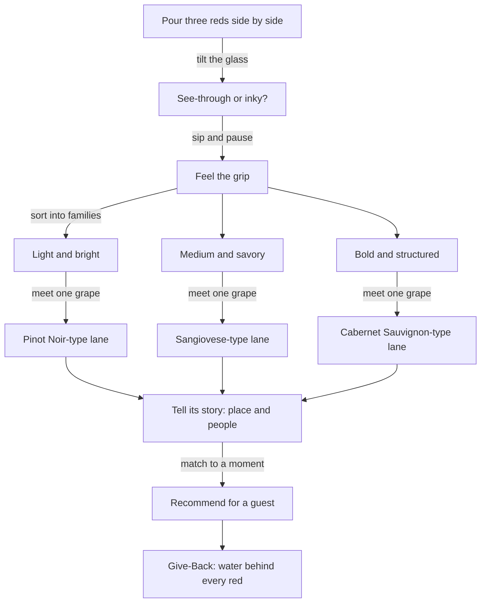

*Sip Studios › Ai Edu · Water to Wine*

## 03 · Meeting Red Grapes
**Purpose:** Meet red grapes by feel — weight, grip, and fruit — then learn to speak about them.

**What you practice**
- Sorting reds into Sip Studies weight families: Light, Medium, Bold
- Feeling grip (tannin) and explaining it simply
- Linking grape skin thickness to color and grip
- Telling a 30-second story about one grape's home

**Source vs Flow:** *Source* — recognize light vs bold and name one grape per family. *Flow* — explain why a grape feels the way it does and steer a guest from one family to another.

**Bridge callout:** Bold reds and barrel-aged spirits share vocabulary for grip and wood — learners meet that bridge again in Chart 06.

**Give-Back:** Red wine takes a lot of water to grow and make. Learners estimate one bottle's water story and share one fact a guest might remember.

**Print hint:** Clay headers, Mauve-Grey family boxes, Mint Mist Give-Back band.
