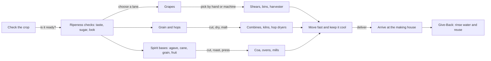

*Sip Studios › Ai Edu · Water to Wine*

## 04 · Harvest & Field Gear
**Purpose:** Follow three crops — grapes, grain/hops, and spirit bases — from field to the making house door.

**What you practice**
- Naming one ripeness signal per crop
- Comparing hand harvest vs machine harvest trade-offs
- Explaining why grain is malted and why agave is cooked
- Tracking time-to-processing and why it matters

**Source vs Flow:** *Source* — name the crop and its main harvest tool. *Flow* — compare how harvest choices change the final drink across all three lanes.

**Give-Back:** Harvest and cleanup use large volumes of water. Learners list one reuse or capture idea and connect it to Somm Support's access projects.

**Print hint:** Mint Mist crop lanes, Sand gear boxes, Deep Teal arrows.
