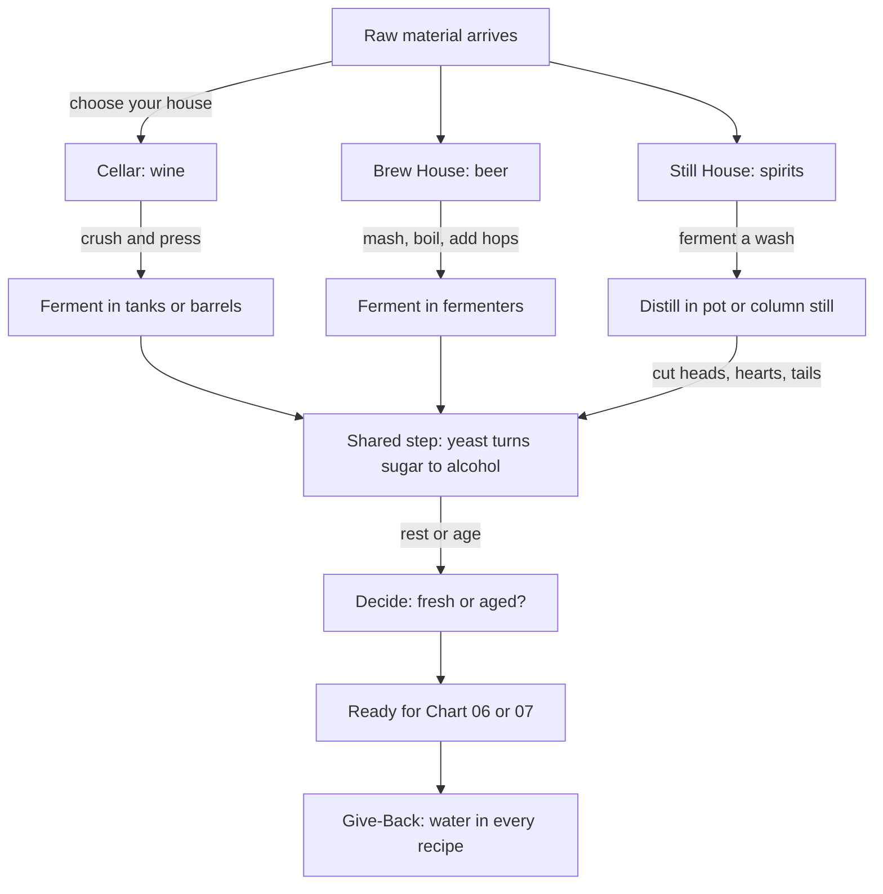

*Sip Studios › Ai Edu · Water to Wine*

## 05 · Making Houses: Cellar, Brew House, Still House
**Purpose:** Tour three making houses and see how each turns sugar into drink.

**What you practice**
- Naming the key vessel in each house: press, mash tun, still
- Explaining fermentation as the shared heart of all three
- Telling pot still from column still in one sentence
- Mapping where water enters each process

**Source vs Flow:** *Source* — name each house's main step and equipment. *Flow* — compare how the same idea (sugar → alcohol) creates different drinks, and recommend which house a guest's favorite came from.

**Give-Back:** Beer is mostly water; spirits are cut with water; wineries clean with water. Learners pick one house and write its water-saving pledge.

**Print hint:** Three columns — Clay (cellar), Sand (brew house), Mauve-Grey (still house); Deep Teal shared step.
