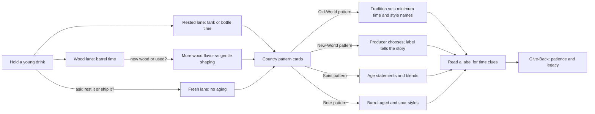

*Sip Studios › Ai Edu · Water to Wine*

## 06 · Aging Patterns & Country Styles
**Purpose:** Learn how time, wood, and local tradition shape style — using Sip Studies scaffolds, not rulebooks.

**What you practice**
- Sorting a drink into Fresh, Rested, or Wood lanes
- Explaining what a barrel adds
- Using four Sip Studies pattern cards to read a label for aging clues
- Explaining why some places set aging rules and others don't

**Source vs Flow:** *Source* — recognize whether a drink was aged and in what. *Flow* — compare two country patterns and recommend a fresh or aged option for a guest. (Learners look up current local rules from official sources; Sip Studies teaches the pattern, not the numbers.)

**Give-Back:** Aging is legacy — something made now for people later. Learners connect that to building water access that lasts beyond one season.

**Print hint:** Sand timeline band, Clay wood lane, Deep Teal pattern cards.
