*Sip Studios › Ai Edu · Water to Wine*

## 07 · Bottle to Shelf: Packaging & Distribution
**Purpose:** Follow a finished drink from tank to the shop or restaurant door.

```mermaid
flowchart LR
  A["Finished drink in tank"] -->|"filter or not?"| B["Clarify and stabilize"]
  B -->|"choose a package"| C["Bottle, can, keg, or box"]
  C -->|"close it"| D["Cork, screwcap, crown, or keg coupler"]
  D -->|"label it"| E["Label and lot code"]
  E -->|"ship it"| F["Producer to importer or distributor"]
  F -->|"store it right"| G["Warehouse: cool, dark, rotated"]
  G -->|"deliver"| H["Retailer or restaurant"]
  H --> I["Track freshness: beer fast, wine and spirits slower"]
  I --> J["Give-Back: lighter packaging, less waste"]
```

**What you practice**
- Matching package type to drink and use (can for beer, keg for draft, bottle for wine)
- Explaining why closures matter
- Drawing the producer → distributor → seller path in your area
- Spotting freshness and storage risks

**Source vs Flow:** *Source* — name the package, closure, and main hand-offs. *Flow* — explain why a package was chosen and how distribution affects price and freshness for a guest.

**Give-Back:** Lighter glass, cans, and kegs cut shipping weight and water use. Learners propose one swap a local shop or bar could make.

**Print hint:** Deep Teal path line, Mint Mist stops, Clay Give-Back stamp.
