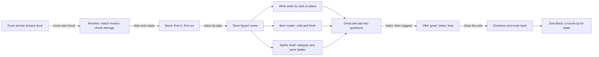

*Sip Studios › Ai Edu · Water to Wine*

## 08 · Retail Floor: Selling, Layout, Receiving & Stocking
**Purpose:** Walk a shop from the back dock to the checkout and learn how wine, beer, and spirits move.

**What you practice**
- Receiving a delivery and flagging a mistake
- Rotating stock so the oldest sells first
- Laying out a section so guests find things fast
- Asking two discovery questions and offering three price points

**Source vs Flow:** *Source* — name the steps from dock to shelf and the main zones. *Flow* — redesign a section for a store's guests and recommend across wine, beer, and spirits.

**Give-Back:** A shop can host a "Water to Wine" round-up at checkout. Learners write the one-line ask they'd say to a guest.

**Print hint:** Sand floor plan, Deep Teal zones, Clay guest path.
