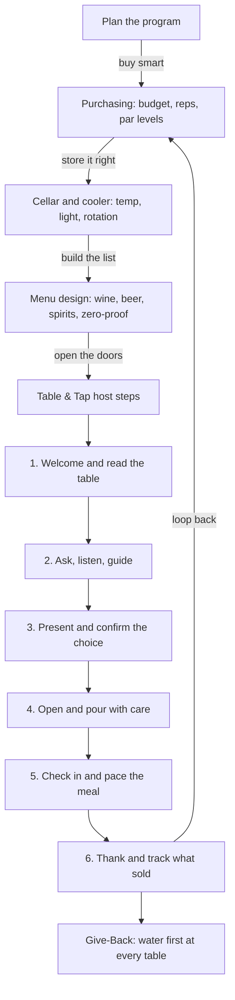

*Sip Studios › Ai Edu · Water to Wine*

## 09 · Table & Tap: Restaurant Selling, Cellaring, Menus, Purchasing & Host Steps
**Purpose:** Run the beverage side of a restaurant — from buying and storing to guiding a guest at the table.

**What you practice**
- Setting par levels and reading a sales report
- Organizing a cellar or cooler for easy, safe service
- Building a short, balanced list across wine, beer, spirits, and zero-proof
- Walking the six Sip Studies Table & Tap host steps in your own words

**Source vs Flow:** *Source* — name the program parts and the six host steps. *Flow* — design a mini menu for a concept, buy for it, and guide a guest from question to pour.

**Give-Back:** Table & Tap starts with water — every guest is offered a glass first. Programs can tag one menu item as a "Water to Wine" pour that funds Somm Support access.

**Print hint:** Clay host-step ribbon, Deep Teal program boxes, Mint Mist Give-Back footer.
