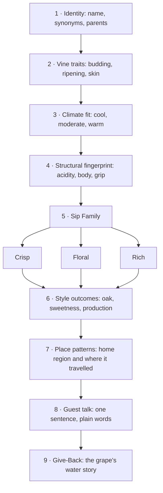
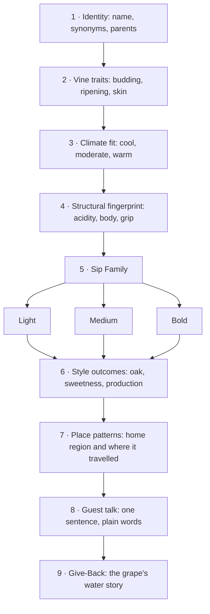
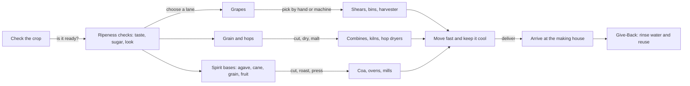
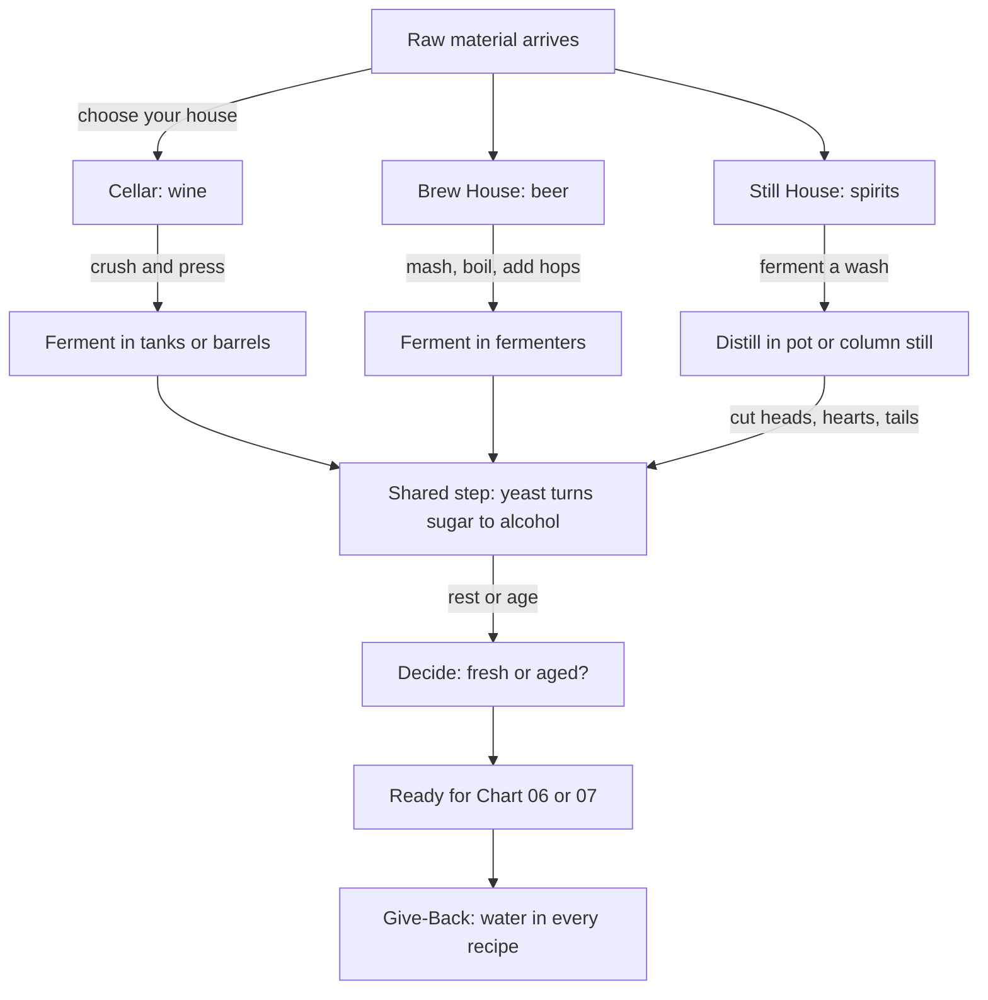
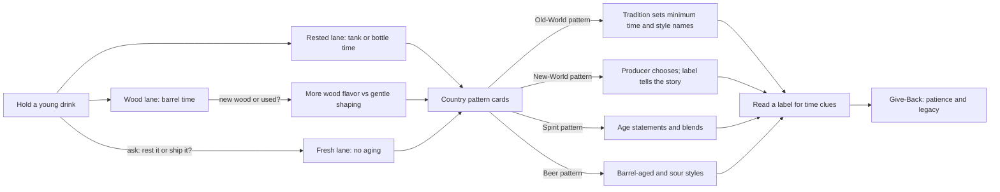
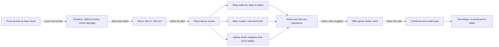
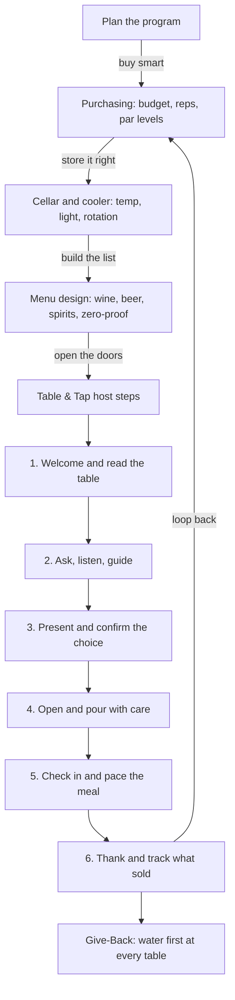

# Sip Studies · Ai Edu — Experience Charts (Wine · Beer · Spirits)

*Sip Studios › Ai Edu · Beverage Bridges under "Water to Wine" · Somm Support water accessibility through-line*
*Values: Culture · Credible · Catalyze · Legacy*

> Original Sip Studies teaching material. Not affiliated with, endorsed by, or derived from any court, guild, or credentialing body.

## Index

| # | Chart | Lanes |
|---|-------|-------|
| 01 | Vine Training & Canopy Care | W (bridge callout: B, S) |
| 02 | White Grape Varieties — Species Analysis | W (bridge callout: S) |
| 03 | Red Grape Varieties — Species Analysis | W (bridge callout: S) |
| 04 | Harvest & Field Gear | W · B · S |
| 05 | Making Houses: Cellar, Brew House, Still House | W · B · S |
| 06 | Aging Patterns & Country Styles | W · B · S |
| 07 | Bottle to Shelf: Packaging & Distribution | W · B · S |
| 08 | Retail Floor: Selling, Layout, Receiving & Stocking | W · B · S |
| 09 | Table & Tap: Restaurant Selling, Cellaring, Menus, Purchasing & Host Steps | W · B · S |

**Lanes:** W = wine · B = beer · S = spirits
**Depth:** *Source* = recognize and name · *Flow* = connect, compare, recommend
**Palette:** Clay #914C2C · Deep Teal #1A5552 · Mauve-Grey #817985 · Mint Mist #D8E6DA · Sand #EDD4A8

---

## 01 · Vine Training & Canopy Care
**Purpose:** Walk a vineyard row and see how people shape a vine to manage sun, air, and water.

**What you practice**
- Naming two or three common vine shapes by sight
- Explaining why leaf thinning or keeping shade changes ripeness
- Connecting irrigation choices to climate and water scarcity
- Asking a grower one good "why" question

**Source vs Flow:** *Source* — recognize a trained vs untrained vine and say what a canopy does. *Flow* — connect a site's water and sun to its training choice and predict the style effect.

**Bridge callout:** Hops climb trellises too — barley and grain fields and hop yards face the same sun, air, and water trade-offs. Agave and grain for spirits are farmed crops with their own water footprint.

**Give-Back:** Every vineyard decision is a water decision. Learners note one water-saving practice and how a similar idea could help a community well or garden.

**Print hint:** Deep Teal headers, Mint Mist node fill, Clay arrows.

---

## 02 · White Grape Varieties — Species Analysis
> Original Sip Studies teaching material. Variety names are public, common names. Not affiliated with, endorsed by, or derived from any court, guild, or credentialing body.

**Purpose:** Analyze the core white wine grapes as plants and as styles: who each variety is, where it grows best, how its structure reads, and how to explain it to a guest.

### How to analyze a grape (Sip Studies nine steps)

**Sip Families (white):** *Crisp* = high acid, light body, little or no oak · *Floral* = aromatic, perfumed, often lower acid or with sweetness · *Rich* = fuller body, often oak, ripeness, or lees texture. A variety can move between families depending on climate and winemaking (shown with →).

### Variety analysis table (11 varieties)

| Variety | Sip Family | Vine traits | Climate fit | Structure (acidity · body · grip) | Style cues | Place patterns | Water / Give-Back note |
|---|---|---|---|---|---|---|---|
| **Albariño** | Crisp | Thick-skinned, holds up to damp sea air; often grown on high pergolas | Cool, wet, coastal | High · light–medium · none | Mostly steel tank, no oak; dry; sometimes rests on its yeast for texture | Atlantic Iberia (Galicia, northern Portugal as Alvarinho); a few US coastal sites | Rain-fed coastal vineyards: compare to drought-stressed inland sites |
| **Chardonnay** | Rich (can be Crisp) | Early budding, frost-prone; very adaptable, a winemaker's blank canvas | Cool to warm; style follows climate | Medium–high · medium–full · none | Widest range: steel and lean, or barrel-fermented, buttery, and round; also a core sparkling grape | Burgundy and Champagne home; California, Australia, Chile, Oregon, many more | Same grape, many climates: a lesson in how water and heat shape one plant |
| **Chenin Blanc** | Crisp → Rich | Vigorous, buds early, ripens late; prone to noble rot in misty sites | Cool-moderate to warm | Very high · light–full · none | Every sweetness level from bone dry to dessert; still or sparkling; oak optional | Loire Valley home; South Africa's most planted white; some California | South African old bush vines are often dry-farmed: a water-wise model |
| **Gewürztraminer** | Floral | Pink-skinned, low-yielding, buds early; sensitive to frost and disease | Cool, sunny, dry autumns | Low · full · slight phenolic grip | Dry to sweet; usually no oak; perfumed and oily-textured | Alsace, northern Italy (Alto Adige), Germany; cool US/NZ sites | Low-acid grape: teach why cool nights (and water in the soil) keep it balanced |
| **Pinot Grigio / Pinot Gris** | Crisp (Grigio) · Rich (Gris) | Grey-pink skin, a color mutation of Pinot Noir; early ripening | Cool to moderate | Medium · light–full · none | Two names, two styles: light and zippy (Grigio) or riper and rounder (Gris); rarely oaked | Northeast Italy, Alsace, Oregon, New Zealand | Mutation story: one vine family, many faces, same water needs |
| **Riesling** | Floral (and Crisp) | Hard wood resists winter cold; late ripening; reflects soil strongly | Cool, long seasons, steep slopes | Very high · light–medium · none | Bone dry to very sweet; almost never oaked; ages for decades | Germany home; Alsace, Austria, Australia's cool valleys, New York Finger Lakes, Washington | Steep river slopes: how rivers temper climate and support growers |
| **Sauvignon Blanc** | Crisp | Vigorous vine; needs canopy control to keep grassy vs ripe balance | Cool to moderate | High · light–medium · none | Mostly steel and fresh; some barrel-aged and blended with Sémillon | Loire Valley and Bordeaux home; New Zealand, Chile, South Africa, California | Irrigation and vigor: more water = more leaves = greener style |
| **Torrontés** | Floral | Argentine crossing (Muscat parent); thrives at extreme altitude | High-altitude desert: hot days, cold nights | Medium · medium · slight | Dry, unoaked, aromatic | Argentina's high north (Salta) and Mendoza/La Rioja | Desert vineyards rely on snowmelt irrigation: a direct water-access story |
| **Grüner Veltliner** | Crisp | Native Austrian; high-yielding unless restrained; loves loess soils | Cool continental | High · light–full · none | Mostly dry, unoaked; light everyday to rich reserve styles | Austria (Danube valleys); small plantings in US, NZ, Australia | Danube terraces: river water and stone walls that store heat |
| **Viognier** | Floral → Rich | Low, irregular yields; needs full ripeness to show its character | Warm, sunny | Low · full · slight | Dry, often lightly oaked; sometimes co-fermented with Syrah | Northern Rhône home; California, Australia, Virginia | Heat-loving grape: discuss water stress in warming climates |
| **Sémillon** | Rich | Thin skin, prone to noble rot; ages into honeyed richness | Moderate; misty autumns for sweet styles | Low–medium · medium–full · none | Dry blends with Sauvignon Blanc, or sweet botrytis wines; ages well | Bordeaux (including sweet Sauternes); Australia (Hunter Valley) | Morning river mist creates sweet wines: water as a winemaking ingredient |

*Place patterns are high-level teaching anchors, not a complete or official list. Learners confirm current regional rules from official sources.*

**What you practice**
- Run the nine-step analysis on one variety and fill one table row from memory
- Explain how climate moves a grape between Crisp and Rich (Chardonnay, Chenin Blanc)
- Name a variety's home region and one place it travelled to
- Say one guest-ready sentence per variety

**Source vs Flow:** *Source:* name each variety, place it in its Sip Family, and give its climate fit and one home region. *Flow:* compare two varieties step by step (for example Riesling vs Gewürztraminer), predict style from climate and winemaking, and recommend one to a guest with a reason.

**Bridge callout:** Grape spirits (brandies, pomace spirits) start from white grapes like Ugni Blanc, Folle Blanche, and Muscat relatives: same fruit, a different house.

**Give-Back:** Each variety row ends with a water note. Learners pick one white and write its water story in two sentences: how the vine gets its water and one way a grower saves it. Somm Support uses these stories at Water to Wine events.

**Print hint:** Sand background, Deep Teal table header, Mint Mist rows for Crisp, Mauve-Grey tint for Floral, Clay accent for Rich.

---

## 03 · Red Grape Varieties — Species Analysis
> Original Sip Studies teaching material. Variety names are public, common names. Not affiliated with, endorsed by, or derived from any court, guild, or credentialing body.

**Purpose:** Analyze the core red wine grapes as plants and as styles: skin, ripening, structure, place, and how to explain each one to a guest.

### How to analyze a grape (Sip Studies nine steps)

**Sip Families (red):** *Light* = pale, high acid, low grip · *Medium* = balanced fruit, acid, and grip; often savory · *Bold* = deep color or high tannin, full body, often oak. Skin thickness and climate decide most of the move between families (shown with →).

### Variety analysis table (14 varieties)

| Variety | Sip Family | Vine traits | Climate fit | Structure (acidity · body · grip) | Style cues | Place patterns | Water / Give-Back note |
|---|---|---|---|---|---|---|---|
| **Cabernet Franc** | Medium | Buds and ripens earlier than Cabernet Sauvignon; hardy in cooler sites | Cool to moderate | Medium–high · medium · medium | Unoaked and fresh or barrel-aged; key blending partner | Loire Valley and Bordeaux; Finger Lakes, Virginia, Argentina | Cooler-site grape: lower irrigation needs than many bold reds |
| **Cabernet Sauvignon** | Bold | Small, thick-skinned berries; late ripening; offspring of Cabernet Franc × Sauvignon Blanc | Warm, long seasons; gravelly, well-drained soils | Medium–high · full · high | Usually oak-aged; blended or single variety; long aging | Bordeaux (Left Bank) home; Napa, Washington, Chile, Australia, South Africa | Well-drained gravel: how soil holds or sheds water |
| **Gamay** | Light | Early budding and ripening; high yielding | Cool to moderate | High · light · low | Often whole-cluster fermented for juicy freshness; rarely oaked; served slightly cool | Beaujolais home; Loire, Switzerland, Oregon | Granite hillside vineyards rely on rain: a dry-farming story |
| **Grenache / Garnacha** | Medium → Bold | Drought-tolerant bush vine; high sugar; thin-ish skin | Hot, dry, windy | Low–medium · full · medium | Often blended (with Syrah, Mourvèdre); also rosé and fortified | Southern Rhône, Spain (Priorat, Navarra, Aragón), Sardinia (Cannonau), Australia | Drought-tolerant bush vines: the model for water-wise vineyards |
| **Malbec** | Bold | Thick skins; benefits from strong sunlight at altitude | High-altitude sun with cool nights; or warm southwest France | Medium · full · medium–high | Often oak-aged; deep color; single variety in Argentina | Argentina (Mendoza) and Cahors, France | Andean snowmelt irrigation: water access shapes a whole region |
| **Merlot** | Medium → Bold | Early ripening, thinner skin than Cabernet; loves clay | Moderate to warm | Medium · medium–full · medium | Often oak-aged; soft structure; major blending grape | Bordeaux (Right Bank) home; Italy, Washington, California, Chile | Clay soils hold water: compare to gravel sites for Cabernet |
| **Nebbiolo** | Bold (light color) | Buds early, ripens very late; thin color but high tannin | Cool-moderate, foggy autumns | High · medium–full · high | Long barrel and bottle aging; pale color fools the eye | Piedmont (Barolo, Barbaresco) home; Valtellina; tiny New World plantings | Named for fog (nebbia): water in the air is part of the identity |
| **Pinot Noir** | Light | Thin-skinned, disease-prone, genetically unstable (many clones) | Cool | High · light–medium · low–medium | Often aged in barrel gently; core sparkling grape | Burgundy and Champagne home; Oregon, California coast, New Zealand, Germany (Spätburgunder) | Fragile grape: canopy and moisture control as care, tie back to Chart 01 |
| **Sangiovese** | Medium | Many local clones; slow, late ripening | Warm days, hillsides | High · medium · medium–high | Traditional large casks or small new oak; single variety or blended | Tuscany (Chianti, Montalcino, Montepulciano) home; Romagna; some California, Australia | Hill-town agriculture: shared water systems in rural communities |
| **Syrah / Shiraz** | Bold | Vigorous; shows site strongly; two names signal two styles | Moderate (Syrah) to hot (Shiraz) | Medium · full · medium–high | Oak-aged; sometimes co-fermented with Viognier; blend or solo | Northern Rhône home; Australia (Barossa, McLaren Vale), Washington, Chile, South Africa | Same grape, two names: how climate and water change a style |
| **Tempranillo** | Medium → Bold | Thick-skinned; ripens early ('temprano' = early) | Continental: hot days, cold nights | Medium · medium–full · medium | Classic long oak aging tiers from young to long-aged; also unoaked young styles | Spain (Rioja, Ribera del Duero, Toro); Portugal (Tinta Roriz); some Texas, Oregon | High dry plateaus: irrigation was restricted for decades in Spain |
| **Zinfandel / Primitivo** | Bold | Uneven ripening in the same cluster; very old vines survive | Warm to hot | Medium · full · medium | Oak-aged, high alcohol, jammy; also off-dry blush versions | California (Lodi, Sonoma, Paso Robles); southern Italy (Puglia, as Primitivo); Croatian ancestor | Century-old dry-farmed vines: heritage and water thrift together |
| **Barbera** | Medium | Vigorous; keeps acidity even in heat | Moderate to warm | Very high · medium · low | Unoaked and juicy or barrel-aged and richer | Piedmont (Asti, Alba); California Sierra Foothills; Argentina | Everyday table wine: affordable pours that can fund a Give-Back round-up |
| **Mourvèdre / Monastrell** | Bold | Late budding and ripening; needs heat and water at the root | Hot, coastal-Mediterranean | Medium · full · high | Often blended (GSM); can age long | Bandol (Provence), Southern Rhône, Spain (Jumilla, Monastrell), Australia (Mataro) | Needs warmth plus some water: a balance lesson for hot regions |

*Place patterns are high-level teaching anchors, not a complete or official list. Learners confirm current regional rules from official sources.*

**What you practice**
- Run the nine-step analysis on one variety and fill one table row from memory
- Link skin thickness and ripening time to color and grip
- Explain synonym pairs (Syrah/Shiraz, Grenache/Garnacha, Zinfandel/Primitivo, Mourvèdre/Monastrell)
- Say one guest-ready sentence per variety

**Source vs Flow:** *Source:* name each variety, place it in its Sip Family, and give its climate fit and one home region. *Flow:* compare two varieties step by step (for example Nebbiolo vs Pinot Noir: both pale, very different grip), predict style from site and winemaking, and guide a guest from one family to another.

**Bridge callout:** Bold, oak-aged reds and barrel-aged spirits share vocabulary for grip and wood. Learners meet that bridge again in Chart 06.

**Give-Back:** Red grapes need long seasons and often irrigation. Learners pick one dry-farmed or water-wise red (old-vine Zinfandel, bush-vine Grenache) and share one fact a guest might remember. Each story can headline a Water to Wine pour.

**Print hint:** Clay headers, Deep Teal table header, Sand rows for Light, Mint Mist for Medium, Mauve-Grey tint for Bold.

---

## 04 · Harvest & Field Gear
**Purpose:** Follow three crops — grapes, grain/hops, and spirit bases — from field to the making house door.

**What you practice**
- Naming one ripeness signal per crop
- Comparing hand harvest vs machine harvest trade-offs
- Explaining why grain is malted and why agave is cooked
- Tracking time-to-processing and why it matters

**Source vs Flow:** *Source* — name the crop and its main harvest tool. *Flow* — compare how harvest choices change the final drink across all three lanes.

**Give-Back:** Harvest and cleanup use large volumes of water. Learners list one reuse or capture idea and connect it to Somm Support's access projects.

**Print hint:** Mint Mist crop lanes, Sand gear boxes, Deep Teal arrows.

---

## 05 · Making Houses: Cellar, Brew House, Still House
**Purpose:** Tour three making houses and see how each turns sugar into drink.

**What you practice**
- Naming the key vessel in each house: press, mash tun, still
- Explaining fermentation as the shared heart of all three
- Telling pot still from column still in one sentence
- Mapping where water enters each process

**Source vs Flow:** *Source* — name each house's main step and equipment. *Flow* — compare how the same idea (sugar → alcohol) creates different drinks, and recommend which house a guest's favorite came from.

**Give-Back:** Beer is mostly water; spirits are cut with water; wineries clean with water. Learners pick one house and write its water-saving pledge.

**Print hint:** Three columns — Clay (cellar), Sand (brew house), Mauve-Grey (still house); Deep Teal shared step.

---

## 06 · Aging Patterns & Country Styles
**Purpose:** Learn how time, wood, and local tradition shape style — using Sip Studies scaffolds, not rulebooks.

**What you practice**
- Sorting a drink into Fresh, Rested, or Wood lanes
- Explaining what a barrel adds
- Using four Sip Studies pattern cards to read a label for aging clues
- Explaining why some places set aging rules and others don't

**Source vs Flow:** *Source* — recognize whether a drink was aged and in what. *Flow* — compare two country patterns and recommend a fresh or aged option for a guest. (Learners look up current local rules from official sources; Sip Studies teaches the pattern, not the numbers.)

**Give-Back:** Aging is legacy — something made now for people later. Learners connect that to building water access that lasts beyond one season.

**Print hint:** Sand timeline band, Clay wood lane, Deep Teal pattern cards.

---

## 07 · Bottle to Shelf: Packaging & Distribution
**Purpose:** Follow a finished drink from tank to the shop or restaurant door.

**What you practice**
- Matching package type to drink and use (can for beer, keg for draft, bottle for wine)
- Explaining why closures matter
- Drawing the producer → distributor → seller path in your area
- Spotting freshness and storage risks

**Source vs Flow:** *Source* — name the package, closure, and main hand-offs. *Flow* — explain why a package was chosen and how distribution affects price and freshness for a guest.

**Give-Back:** Lighter glass, cans, and kegs cut shipping weight and water use. Learners propose one swap a local shop or bar could make.

**Print hint:** Deep Teal path line, Mint Mist stops, Clay Give-Back stamp.

---

## 08 · Retail Floor: Selling, Layout, Receiving & Stocking
**Purpose:** Walk a shop from the back dock to the checkout and learn how wine, beer, and spirits move.

**What you practice**
- Receiving a delivery and flagging a mistake
- Rotating stock so the oldest sells first
- Laying out a section so guests find things fast
- Asking two discovery questions and offering three price points

**Source vs Flow:** *Source* — name the steps from dock to shelf and the main zones. *Flow* — redesign a section for a store's guests and recommend across wine, beer, and spirits.

**Give-Back:** A shop can host a "Water to Wine" round-up at checkout. Learners write the one-line ask they'd say to a guest.

**Print hint:** Sand floor plan, Deep Teal zones, Clay guest path.

---

## 09 · Table & Tap: Restaurant Selling, Cellaring, Menus, Purchasing & Host Steps
**Purpose:** Run the beverage side of a restaurant — from buying and storing to guiding a guest at the table.

**What you practice**
- Setting par levels and reading a sales report
- Organizing a cellar or cooler for easy, safe service
- Building a short, balanced list across wine, beer, spirits, and zero-proof
- Walking the six Sip Studies Table & Tap host steps in your own words

**Source vs Flow:** *Source* — name the program parts and the six host steps. *Flow* — design a mini menu for a concept, buy for it, and guide a guest from question to pour.

**Give-Back:** Table & Tap starts with water — every guest is offered a glass first. Programs can tag one menu item as a "Water to Wine" pour that funds Somm Support access.

**Print hint:** Clay host-step ribbon, Deep Teal program boxes, Mint Mist Give-Back footer.

---
*© Sip Studios · Ai Edu. Original Sip Studies material. Grape, beer, and spirit category names are public terms used in Sip Studies' own teaching frame.*
