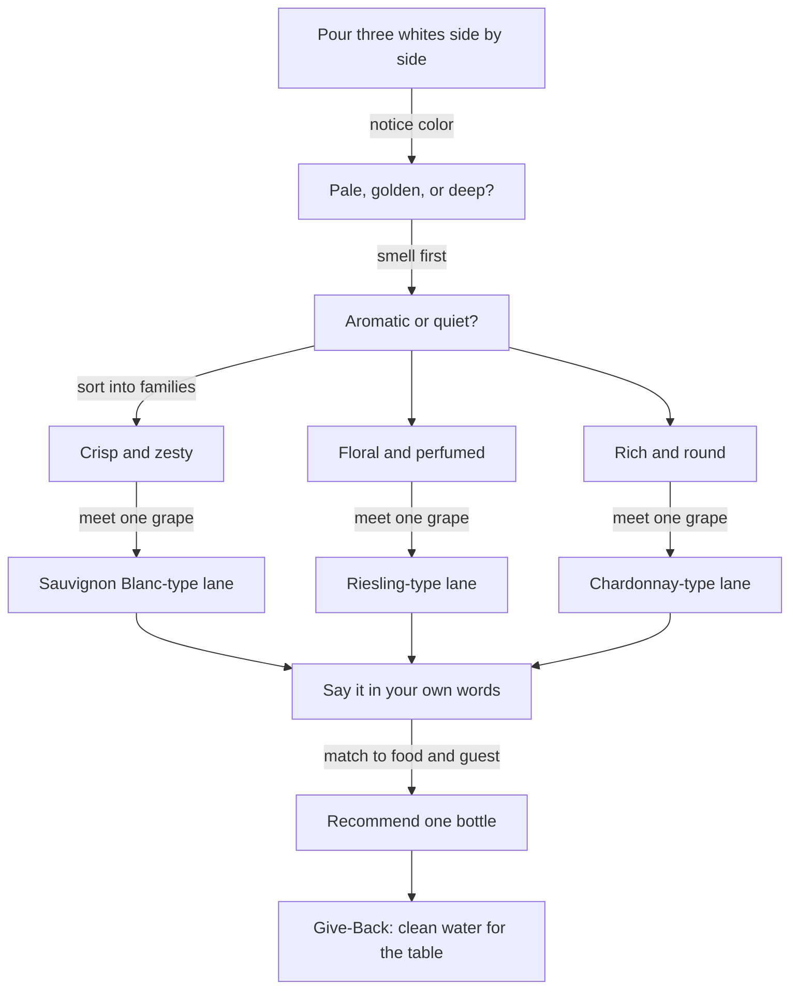
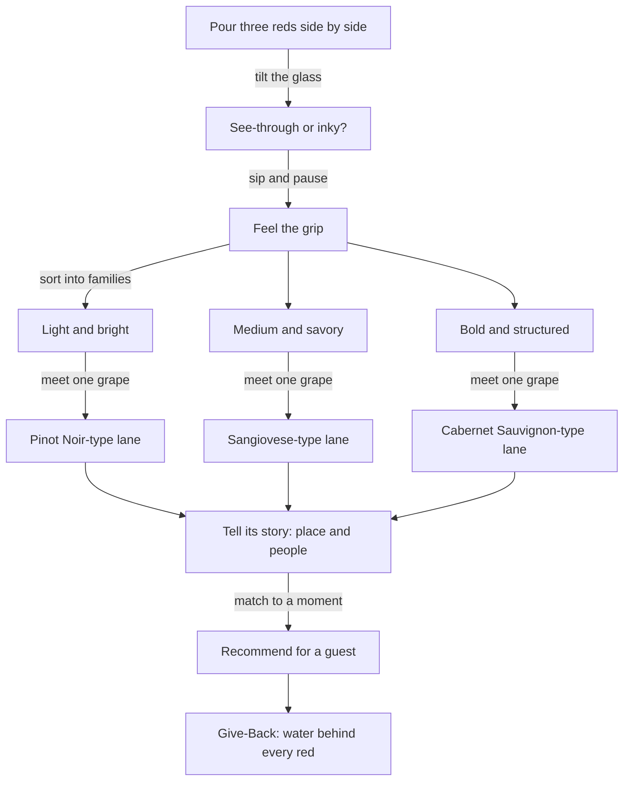
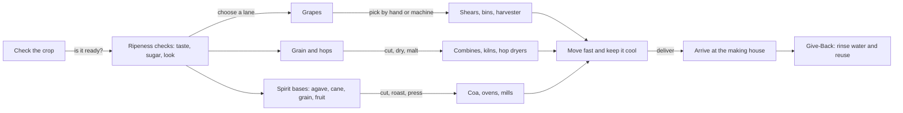
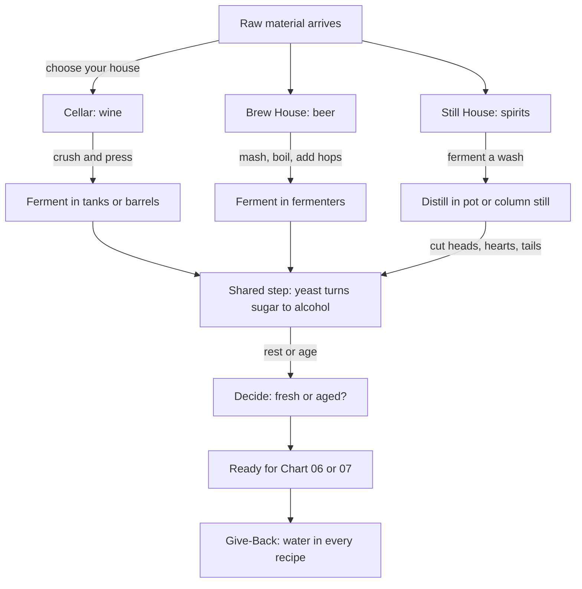
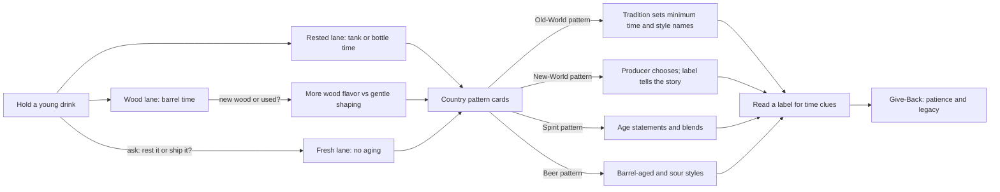
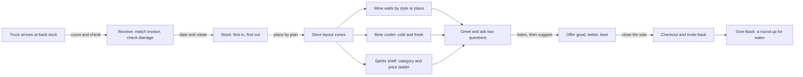
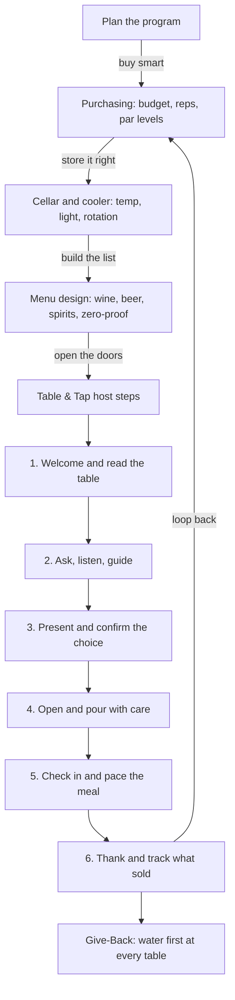

# Sip Studies · Ai Edu — Experience Charts (Wine · Beer · Spirits)

*Sip Studios › Ai Edu · Beverage Bridges under "Water to Wine" · Somm Support water accessibility through-line*
*Values: Culture · Credible · Catalyze · Legacy*

> Original Sip Studies teaching material. Not affiliated with, endorsed by, or derived from any court, guild, or credentialing body.

## Index

| # | Chart | Lanes |
|---|-------|-------|
| 01 | Vine Training & Canopy Care | W (bridge callout: B, S) |
| 02 | Meeting White Grapes | W (bridge callout: S) |
| 03 | Meeting Red Grapes | W (bridge callout: S) |
| 04 | Harvest & Field Gear | W · B · S |
| 05 | Making Houses: Cellar, Brew House, Still House | W · B · S |
| 06 | Aging Patterns & Country Styles | W · B · S |
| 07 | Bottle to Shelf: Packaging & Distribution | W · B · S |
| 08 | Retail Floor: Selling, Layout, Receiving & Stocking | W · B · S |
| 09 | Table & Tap: Restaurant Selling, Cellaring, Menus, Purchasing & Host Steps | W · B · S |

**Lanes:** W = wine · B = beer · S = spirits
**Depth:** *Source* = recognize and name · *Flow* = connect, compare, recommend
**Palette:** Clay #914C2C · Deep Teal #1A5552 · Mauve-Grey #817985 · Mint Mist #D8E6DA · Sand #EDD4A8

---

## 01 · Vine Training & Canopy Care
**Purpose:** Walk a vineyard row and see how people shape a vine to manage sun, air, and water.

```mermaid
flowchart LR
  A["Arrive at the row"] -->|"look at the trunk"| B["Spot the vine's frame"]
  B -->|"is it tall or low?"| C["Head-trained vs trellised"]
  C -->|"follow the wires"| D["Cane vs spur pruning"]
  D -->|"step into the leaves"| E["Canopy: shade or sun?"]
  E -->|"feel the airflow"| F["Disease and moisture risk"]
  F -->|"check the soil"| G["Water: rain, dry-farm, or drip"]
  G -->|"ask the grower"| H["Why this site chose this shape"]
  H -->|"taste the result"| I["Link canopy to ripeness in the glass"]
  I --> J["Give-Back: water stewardship in the vineyard"]
```

**What you practice**
- Naming two or three common vine shapes by sight
- Explaining why leaf thinning or keeping shade changes ripeness
- Connecting irrigation choices to climate and water scarcity
- Asking a grower one good "why" question

**Source vs Flow:** *Source* — recognize a trained vs untrained vine and say what a canopy does. *Flow* — connect a site's water and sun to its training choice and predict the style effect.

**Bridge callout:** Hops climb trellises too — barley and grain fields and hop yards face the same sun, air, and water trade-offs. Agave and grain for spirits are farmed crops with their own water footprint.

**Give-Back:** Every vineyard decision is a water decision. Learners note one water-saving practice and how a similar idea could help a community well or garden.

**Print hint:** Deep Teal headers, Mint Mist node fill, Clay arrows.

---

## 02 · Meeting White Grapes
**Purpose:** A guided meet-and-greet with white grapes — how to group them, taste them, and talk about them.

**What you practice**
- Sorting whites into three Sip Studies families: Crisp, Floral, Rich
- Describing one grape in plain words a guest would understand
- Spotting how oak or no-oak shifts a white's feel
- Picking one white for one dish

**Source vs Flow:** *Source* — name a grape and its family. *Flow* — compare two grapes, explain the climate link, and recommend one to a guest.

**Bridge callout:** Grape spirits (brandies, pomace spirits) start from grapes like these — same fruit, a different house.

**Give-Back:** Learners pair each white with a glass of water in the tasting and note how water resets the palate — the simplest hospitality act, and the one Somm Support funds.

**Print hint:** Sand background, Deep Teal family boxes, Clay "recommend" node.

---

## 03 · Meeting Red Grapes
**Purpose:** Meet red grapes by feel — weight, grip, and fruit — then learn to speak about them.

**What you practice**
- Sorting reds into Sip Studies weight families: Light, Medium, Bold
- Feeling grip (tannin) and explaining it simply
- Linking grape skin thickness to color and grip
- Telling a 30-second story about one grape's home

**Source vs Flow:** *Source* — recognize light vs bold and name one grape per family. *Flow* — explain why a grape feels the way it does and steer a guest from one family to another.

**Bridge callout:** Bold reds and barrel-aged spirits share vocabulary for grip and wood — learners meet that bridge again in Chart 06.

**Give-Back:** Red wine takes a lot of water to grow and make. Learners estimate one bottle's water story and share one fact a guest might remember.

**Print hint:** Clay headers, Mauve-Grey family boxes, Mint Mist Give-Back band.

---

## 04 · Harvest & Field Gear
**Purpose:** Follow three crops — grapes, grain/hops, and spirit bases — from field to the making house door.

**What you practice**
- Naming one ripeness signal per crop
- Comparing hand harvest vs machine harvest trade-offs
- Explaining why grain is malted and why agave is cooked
- Tracking time-to-processing and why it matters

**Source vs Flow:** *Source* — name the crop and its main harvest tool. *Flow* — compare how harvest choices change the final drink across all three lanes.

**Give-Back:** Harvest and cleanup use large volumes of water. Learners list one reuse or capture idea and connect it to Somm Support's access projects.

**Print hint:** Mint Mist crop lanes, Sand gear boxes, Deep Teal arrows.

---

## 05 · Making Houses: Cellar, Brew House, Still House
**Purpose:** Tour three making houses and see how each turns sugar into drink.

**What you practice**
- Naming the key vessel in each house: press, mash tun, still
- Explaining fermentation as the shared heart of all three
- Telling pot still from column still in one sentence
- Mapping where water enters each process

**Source vs Flow:** *Source* — name each house's main step and equipment. *Flow* — compare how the same idea (sugar → alcohol) creates different drinks, and recommend which house a guest's favorite came from.

**Give-Back:** Beer is mostly water; spirits are cut with water; wineries clean with water. Learners pick one house and write its water-saving pledge.

**Print hint:** Three columns — Clay (cellar), Sand (brew house), Mauve-Grey (still house); Deep Teal shared step.

---

## 06 · Aging Patterns & Country Styles
**Purpose:** Learn how time, wood, and local tradition shape style — using Sip Studies scaffolds, not rulebooks.

**What you practice**
- Sorting a drink into Fresh, Rested, or Wood lanes
- Explaining what a barrel adds
- Using four Sip Studies pattern cards to read a label for aging clues
- Explaining why some places set aging rules and others don't

**Source vs Flow:** *Source* — recognize whether a drink was aged and in what. *Flow* — compare two country patterns and recommend a fresh or aged option for a guest. (Learners look up current local rules from official sources; Sip Studies teaches the pattern, not the numbers.)

**Give-Back:** Aging is legacy — something made now for people later. Learners connect that to building water access that lasts beyond one season.

**Print hint:** Sand timeline band, Clay wood lane, Deep Teal pattern cards.

---

## 07 · Bottle to Shelf: Packaging & Distribution
**Purpose:** Follow a finished drink from tank to the shop or restaurant door.

```mermaid
flowchart LR
  A["Finished drink in tank"] -->|"filter or not?"| B["Clarify and stabilize"]
  B -->|"choose a package"| C["Bottle, can, keg, or box"]
  C -->|"close it"| D["Cork, screwcap, crown, or keg coupler"]
  D -->|"label it"| E["Label and lot code"]
  E -->|"ship it"| F["Producer to importer or distributor"]
  F -->|"store it right"| G["Warehouse: cool, dark, rotated"]
  G -->|"deliver"| H["Retailer or restaurant"]
  H --> I["Track freshness: beer fast, wine and spirits slower"]
  I --> J["Give-Back: lighter packaging, less waste"]
```

**What you practice**
- Matching package type to drink and use (can for beer, keg for draft, bottle for wine)
- Explaining why closures matter
- Drawing the producer → distributor → seller path in your area
- Spotting freshness and storage risks

**Source vs Flow:** *Source* — name the package, closure, and main hand-offs. *Flow* — explain why a package was chosen and how distribution affects price and freshness for a guest.

**Give-Back:** Lighter glass, cans, and kegs cut shipping weight and water use. Learners propose one swap a local shop or bar could make.

**Print hint:** Deep Teal path line, Mint Mist stops, Clay Give-Back stamp.

---

## 08 · Retail Floor: Selling, Layout, Receiving & Stocking
**Purpose:** Walk a shop from the back dock to the checkout and learn how wine, beer, and spirits move.

**What you practice**
- Receiving a delivery and flagging a mistake
- Rotating stock so the oldest sells first
- Laying out a section so guests find things fast
- Asking two discovery questions and offering three price points

**Source vs Flow:** *Source* — name the steps from dock to shelf and the main zones. *Flow* — redesign a section for a store's guests and recommend across wine, beer, and spirits.

**Give-Back:** A shop can host a "Water to Wine" round-up at checkout. Learners write the one-line ask they'd say to a guest.

**Print hint:** Sand floor plan, Deep Teal zones, Clay guest path.

---

## 09 · Table & Tap: Restaurant Selling, Cellaring, Menus, Purchasing & Host Steps
**Purpose:** Run the beverage side of a restaurant — from buying and storing to guiding a guest at the table.

**What you practice**
- Setting par levels and reading a sales report
- Organizing a cellar or cooler for easy, safe service
- Building a short, balanced list across wine, beer, spirits, and zero-proof
- Walking the six Sip Studies Table & Tap host steps in your own words

**Source vs Flow:** *Source* — name the program parts and the six host steps. *Flow* — design a mini menu for a concept, buy for it, and guide a guest from question to pour.

**Give-Back:** Table & Tap starts with water — every guest is offered a glass first. Programs can tag one menu item as a "Water to Wine" pour that funds Somm Support access.

**Print hint:** Clay host-step ribbon, Deep Teal program boxes, Mint Mist Give-Back footer.

---
*© Sip Studios · Ai Edu. Original Sip Studies material. Grape, beer, and spirit category names are public terms used in Sip Studies' own teaching frame.*
